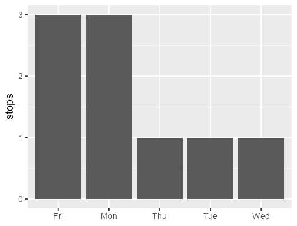
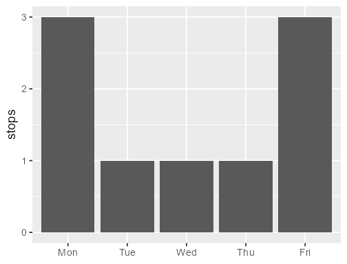
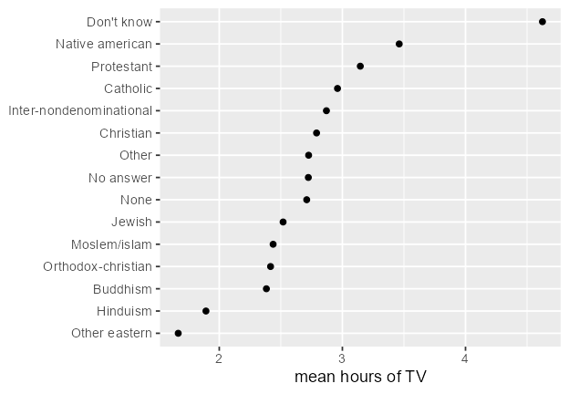

```{r}
#| label: setup
#| include: false
knitr::opts_chunk$set(
  echo = TRUE,
  message = FALSE,
  warning = FALSE,
  fig.width = 6,
  fig.height = 3.6,
  fig.align = "center",
  dpi = 120,
  error = TRUE,
  fig.path = "_figs/forcats-factors/"
)
library(tidyverse)
```

## 1. Values and levels

A factor has two parts.

- **Values.** The category on each row.
- **Levels.** The categories that are allowed, in an order.

Tables, legends, and axes follow the levels. They do not follow the order of the rows. `forcats` comes with `library(tidyverse)`. Every helper starts with `fct_`.

```{r}
library(tidyverse)

fc <- factor(c("B", "A", "B"), levels = c("A", "B", "C"))
fc
```

`C` is a level. No row has that value.

What prints is the label. Under the label, each value is an integer: `1` for the first level, `2` for the second, and so on. That is why `as.numeric()` on a factor of numbers returns the **index**, not the number you see.

```{r}
xf <- factor(c(10, 11, 13, 10))
xf
as.numeric(xf)
parse_number(as.character(xf))
```

`as.character()` gets the labels back. `parse_number()` turns those labels into numbers. `levels(xf)[xf]` is the same recovery without converting to character first: a factor used as an index returns its labels.

`factor()` sorts the levels. `as_factor()` keeps the order the values first appear, which is what you want when the data is already in the right order.

```{r}
factor(c("Wed", "Mon", "Fri", "Mon"))
as_factor(c("Wed", "Mon", "Fri", "Mon"))
```

Set `levels` yourself when the order is a real order, such as months or weekdays. A value that is not in `levels` becomes `NA`.

```{r}
weekdays <- c("Mon", "Tue", "Wed", "Thu", "Fri")
factor(c("Mon", "Sun"), levels = weekdays)
```

`read_csv()` does not make factors. A column stays character until you call `factor()`, `as_factor()`, or `col_factor()` inside `read_csv()`.

A useful longer read: McNamara and Horton, [Wrangling Categorical Data in R](https://doi.org/10.7287/peerj.preprints.3163v2).

---

## 2. The axis follows the levels

Nine bus stops, stored as text. `factor()` with no `levels` argument sorts them alphabetically, so Friday comes before Monday.

```{r}
weekdays <- c("Mon", "Tue", "Wed", "Thu", "Fri")
stops <- tibble(
  day = c("Wed", "Mon", "Fri", "Mon", "Tue", "Fri", "Fri", "Thu", "Mon")
)

stops |>
  mutate(day = factor(day)) |>
  count(day)
```



Pass the order you want. The counts do not change. The rows do not change. The axis does.

```{r}
stops |>
  mutate(day = factor(day, levels = weekdays)) |>
  count(day)
```



On a vertical axis, ggplot draws the **first** level at the bottom. After `coord_flip()`, the first level is at the bottom of a horizontal bar chart. `fct_rev()` flips the current levels when you want the opposite end there.

---

## 3. Level order is not frequency

`gss_cat` is a General Social Survey slice that ships with forcats. `?gss_cat`. The factors you will use are `marital`, `rincome`, `partyid`, and `relig`. `count()` follows the level order, so the first row is the first level, not the largest group.

```{r}
count(gss_cat, partyid)
```

`Independent` is the largest group and the seventh row, because that is where its level sits.

---

## 4. Which function

| You want | Use |
|---|---|
| a fixed order you type (weekdays, months) | `factor(x, levels = )` or `fct_relevel()` |
| levels ordered by a summary of another variable | `fct_reorder()` |
| most common level first | `fct_infreq()` |
| the current order flipped | `fct_rev()` |
| order of first appearance | `as_factor()` or `fct_inorder()` |
| new names, one level at a time | `fct_recode()` |
| several levels of one factor merged into one name | `fct_collapse()` |
| several factor vectors stacked into one factor | `fct_c()` |
| rare levels folded into Other | `fct_lump_n()` or `fct_lump_prop()` |
| unused levels removed | `fct_drop()` |
| a new level before any row has it | `fct_expand()` |
| missing values turned into a level | `fct_na_value_to_level()` |

`fct_c()` stacks vectors. `fct_collapse()` merges levels. Those are different jobs.

---

## 5. `fct_reorder()`

`fct_reorder()` changes the level order. It does not sort the rows. `arrange()` is what reorders rows.

```r
fct_reorder(.f, .x, .fun = median, ..., .desc = FALSE)
```

`.f` is the categorical variable. `.x` is the numeric variable. `.fun` summarizes `.x` inside each level, and that one number decides where the level goes. The default summary is the median. `.desc = TRUE` reverses the order. Extra arguments in `...` are passed on to `.fun`.

`.fun` has to return a single number for each level. A vector has no single place in the order, and `fct_reorder()` errors if it gets one.

Missing numbers in `.x` are dropped, with a warning, unless you set `.na_rm`. `.na_rm = TRUE` drops them quietly. `.na_rm = FALSE` keeps them.

### A summary that is already a function

Mean salary puts Math first, then Physics, then CS.

```{r}
df <- tibble(
  department = c("Math", "Math", "CS", "CS", "Physics", "Physics"),
  salary = c(80, 100, 120, 140, 90, 110)
)

df |>
  mutate(department = fct_reorder(department, salary, .fun = mean)) |>
  pull(department) |>
  levels()
```

| Department | Mean salary |
|---|---|
| Math | 90 |
| Physics | 100 |
| CS | 130 |

### A summary you write

The same helper takes a function you define. This one summarizes each group by the mean of \(x^2 + \cos(x)\).

```{r}
myfun <- function(x) {
  mean(x^2 + cos(x))
}

df2 <- tibble(
  group = c("A", "A", "B", "B", "C", "C"),
  x = c(1, 2, 3, 4, 0, 1)
)

df2 |>
  mutate(group = fct_reorder(group, x, .fun = myfun)) |>
  pull(group) |>
  levels()
```

The function is applied to the rows in each group, separately. The order is C, then A, then B.

Replace the body with `max()` and the groups are ranked by their largest transformed value instead of their average. On **these** six numbers the order does not move: it is still C, A, B.

```{r}
myfun <- function(x) {
  max(x^2 + cos(x))
}

df2 |>
  mutate(group = fct_reorder(group, x, .fun = myfun)) |>
  pull(group) |>
  levels()
```

A smaller set where the choice matters. Group A is `0` and `4`: the mean of \(x^2 + \cos(x)\) is about 8.17, and the max is about 15.3. Group B is `3` and `3.1`: the mean is about 8.31, and the max is about 8.61.

```{r}
df3 <- tibble(
  group = c("A", "A", "B", "B"),
  x = c(0, 4, 3, 3.1)
)

df3 |>
  group_by(group) |>
  summarize(
    mean_fx = mean(x^2 + cos(x)),
    max_fx = max(x^2 + cos(x)),
    .groups = "drop"
  )

df3 |>
  mutate(group = fct_reorder(group, x, .fun = function(x) mean(x^2 + cos(x)))) |>
  pull(group) |>
  levels()

df3 |>
  mutate(group = fct_reorder(group, x, .fun = function(x) max(x^2 + cos(x)))) |>
  pull(group) |>
  levels()
```

The mean order is A, B. The max order is B, A.

### The same idea on `gss_cat`

Here the mean is computed first, one row per religion, and `fct_reorder()` sorts those rows. `arrange(relig)` prints them in the new level order. The plot uses the same order: least TV at the bottom, because that level is first.

```{r}
tv <- gss_cat |>
  filter(!is.na(tvhours)) |>
  group_by(relig) |>
  summarize(hours = mean(tvhours), .groups = "drop") |>
  mutate(relig = fct_reorder(relig, hours)) |>
  arrange(relig)

tv
```



You do not have to summarize first. `fct_reorder()` will take the mean inside each religion. `.na_rm = TRUE` drops missing `tvhours` without a warning. The order matches the table. `Not applicable` is last: every `tvhours` in that group is missing, so there is no mean, and that level is sent to the end.

```{r}
gss_cat |>
  mutate(relig = fct_reorder(relig, tvhours, .fun = mean, .na_rm = TRUE)) |>
  pull(relig) |>
  levels()
```

---

## 6. `fct_infreq()`

`fct_infreq()` orders levels by how often they occur. The most common level is first.

```{r}
fc <- factor(c("A", "B", "A", "C", "A", "B"))
fct_infreq(fc)
```

| Level | Rows |
|---|---|
| A | 3 |
| B | 2 |
| C | 1 |

So the levels are A, B, C. On a vertical bar chart the first level is the left bar, and that bar is the tallest.

```{r}
#| label: infreq-bars
#| fig-alt: "Bars for groups A, B, and C, tallest to shortest."
tibble(group = c("A", "B", "A", "C", "A", "B")) |>
  mutate(group = fct_infreq(group)) |>
  ggplot(aes(x = group)) +
  geom_bar()
```

Mutate the column, then map it. Writing `aes(x = fct_infreq(group))` works, and the axis title becomes the expression.

Pipe `fct_infreq()` into `fct_rev()` when the longest bar should sit on the **right** of a vertical bar chart, or at the **top** of a horizontal one. `marital` below runs from rarest to most common.

```{r}
gss_cat |>
  mutate(marital = marital |> fct_infreq() |> fct_rev()) |>
  count(marital)
```

`fct_relevel()` moves named levels to the front and leaves the rest in their old order. A function in that spot is applied to the level names, so `sort` is alphabetical order.

```{r}
gss_cat |>
  mutate(partyid = fct_relevel(partyid, "Independent")) |>
  count(partyid)

levels(fct_relevel(gss_cat$partyid, sort))
```

---

## 7. `fct_c()` stacks vectors

`fct_c()` binds factor vectors into one factor and keeps every level. The vectors do not need to share levels. It does not invent a new category. It stacks the rows you already have.

```{r}
fc1 <- factor(c("A", "B"), levels = c("A", "B"))
fc2 <- factor(c("C", "D"), levels = c("C", "D"))

fct_c(fc1, fc2)
str(fct_c(fc1, fc2))
```

Since R 4.1.0, base `c()` does the same thing with factors:

```{r}
c(fc1, fc2)
```

---

## 8. `fct_collapse()` merges levels

`fct_collapse()` replaces several levels of **one** factor with one new level. The new name is on the left. The old names are on the right.

```{r}
fc <- factor(c("A", "B", "C", "A", "B", "C"))
fct_collapse(fc, AB = c("A", "B"))
```

`A` and `B` are gone. The rows that had those values are now `AB`.

The same pattern groups departments into fields. Wrap a character column in `factor()` first.

```{r}
tibble(department = c("Math", "Physics", "Chemistry", "History", "English")) |>
  mutate(
    field = fct_collapse(
      factor(department),
      STEM = c("Math", "Physics", "Chemistry"),
      Humanities = c("History", "English")
    )
  )
```

On `gss_cat`, several party answers share one name:

```{r}
gss_cat |>
  mutate(partyid = fct_collapse(
    partyid,
    other = c("No answer", "Don't know", "Other party"),
    rep   = c("Strong republican", "Not str republican"),
    ind   = c("Ind,near rep", "Independent", "Ind,near dem"),
    dem   = c("Not str democrat", "Strong democrat")
  )) |>
  count(partyid)
```

Levels you do not name stay as they are.

`fct_recode()` is the one-name version of the same idea. The **new** name is on the left, the **old** name on the right, the same direction as `mutate()`. A name that matches nothing is left unchanged. `NULL = "old"` drops that level and turns its rows into `NA`.

```{r}
gss_cat |>
  mutate(partyid = fct_recode(
    partyid,
    "Rep, strong" = "Strong republican",
    "Rep, weak"   = "Not str republican",
    "Dem, weak"   = "Not str democrat",
    "Dem, strong" = "Strong democrat"
  )) |>
  count(partyid)
```

Keep these apart.

- `fct_c()` stacks factor vectors.
- `fct_collapse()` merges levels of one factor.
- `fct_recode()` renames levels one at a time.

---

## 9. `fct_drop()` and `fct_expand()`

`fct_drop()` removes levels that no row uses.

```{r}
fc <- factor(c("A", "B", "A"), levels = c("A", "B", "C", "D"))
fc
fct_drop(fc)
```

`C` and `D` were allowed. Neither appears. After `fct_drop()`, the levels are A and B. The rows are unchanged.

`filter()` removes rows. It does not remove levels. This is the usual reason to call `fct_drop()`.

```{r}
grades <- tibble(
  grade = factor(
    c("A", "B", "C", "A", "B"),
    levels = c("A", "B", "C", "D")
  )
)

kept <- grades |> filter(grade != "C")
levels(kept$grade)

kept |>
  mutate(grade = fct_drop(grade)) |>
  pull(grade)
```

After the filter, the values are A and B, and the levels are still A, B, C, and D. `fct_drop()` leaves A and B.

The same thing on `gss_cat`. Keeping only Independents leaves all ten party levels in the attribute.

```{r}
party <- gss_cat |> filter(partyid == "Independent")
levels(party$partyid)

party |>
  mutate(partyid = fct_drop(partyid)) |>
  count(partyid)
```

`fct_expand()` adds levels before any row has them. Lab questions that say "add a level" mean this, not a new observation.

```{r}
fc <- factor(c("A", "B"))
fct_expand(fc, "C", "D")

status <- factor(c("Pending", "Approved", "Pending"))
status2 <- fct_expand(status, "Rejected", "Under Review")
levels(status2)
```

`Approved` and `Pending` were already there, in alphabetical order, because that is what `factor()` does. `Rejected` and `Under Review` are added at the end. No row is assigned to them.

`fct_drop()` removes empty levels. `fct_expand()` adds empty levels.

---

## 10. `fct_na_value_to_level()`

`NA` in a factor is not a level. `count()` skips it. A ggplot2 bar chart still draws those rows, and it parks the bar **after** the last level. `fct_infreq()` and `fct_reorder()` do not move that bar, because they only reorder levels.

`fct_na_value_to_level()` turns the missing values into a real level. `fct_explicit_na()` is the old name, and it is deprecated. Use `fct_na_value_to_level()`.

```{r}
fc <- factor(c("Red", "Blue", NA, "Red", NA))
fc

fc2 <- fct_na_value_to_level(fc, level = "Missing")
fc2
```

`"Missing"` is a level. It is not a missing value. `levels()` lists it, and `count()` will count it.

```{r}
#| label: color-missing
#| fig-alt: "Equal bars for Blue, Red, and Missing."
tibble(color = factor(c("Red", "Blue", NA, "Red", NA, "Blue"))) |>
  mutate(color = fct_na_value_to_level(color, "Missing")) |>
  ggplot(aes(x = color)) +
  geom_bar()
```

To omit the parked `NA` bar instead of naming it, add `scale_x_discrete(na.translate = FALSE)`.

---

## 11. Four orders, one plot

`patchwork` puts ggplot objects on one page. It is not part of the tidyverse. Install it once with `install.packages("patchwork")`.

`starwars` ships with dplyr. `hair_color` is character, so a plain bar chart sorts the colors alphabetically. Five characters have no hair color. Those rows are drawn as `NA` at the end of the axis until they become a level.

```{r}
#| label: hair-compare
#| fig-width: 8.2
#| fig-height: 7.2
#| fig-alt: "Four hair-color bar charts. The first three leave NA at the end. The fourth places Missing by frequency."
library(patchwork)

p1 <- starwars |>
  ggplot(aes(x = hair_color)) +
  geom_bar() +
  coord_flip() +
  labs(title = "Original order", x = NULL)

p2 <- starwars |>
  ggplot(aes(x = fct_reorder(hair_color, height, .fun = max, .na_rm = TRUE))) +
  geom_bar() +
  coord_flip() +
  labs(title = "Ordered by maximum height", x = NULL)

p3 <- starwars |>
  ggplot(aes(x = fct_infreq(hair_color))) +
  geom_bar() +
  coord_flip() +
  labs(title = "Ordered by frequency", x = NULL)

p4 <- starwars |>
  mutate(
    hair_color = fct_na_value_to_level(factor(hair_color), level = "Missing")
  ) |>
  ggplot(aes(x = fct_infreq(hair_color))) +
  geom_bar() +
  coord_flip() +
  labs(title = "Frequency, including missing", x = NULL)

(p1 + p2) / (p3 + p4)
```

`(p1 + p2) / (p3 + p4)` puts the first two plots on top and the last two underneath.

| Plot | Function | What sets the order? |
|---|---|---|
| 1 | none | Alphabetical order of the character values. `NA` is drawn, and it is not a level, so it sits at the end. |
| 2 | `fct_reorder()` | The maximum `height` inside each hair color. `.na_rm = TRUE` drops missing heights before the max. The `NA` bar stays at the end. |
| 3 | `fct_infreq()` | How many rows use each hair color. The `NA` bar stays at the end. |
| 4 | `fct_na_value_to_level()` then `fct_infreq()` | Frequency, with the missing rows as a level named Missing, so that bar is placed with the others. |

The bar lengths are still counts. In plot 2, maximum height chooses the **order** of the colors. It does not choose the length of the bars.

`fct_na_value_to_level()` needs a factor. `hair_color` is character, so plot 4 wraps it in `factor()` first. `.na_rm` belongs to `fct_reorder()`. Writing `na.rm = TRUE` in that call does not set it. That name is passed through `...` to `max()`.

---

## 12. Rare levels

A religion plot with fifteen labels is hard to read. `fct_lump_n(f, n)` keeps the `n` most common levels and folds the rest into `Other`. `Other` is an extra level, so `n = 5` produces **six** rows.

```{r}
gss_cat |>
  mutate(relig = fct_lump_n(relig, n = 5)) |>
  count(relig, sort = TRUE)
```

`fct_lump_prop(f, prop)` keeps levels that are at least that share of the rows. Ten percent leaves three religions, plus `Other`.

```{r}
gss_cat |>
  mutate(relig = fct_lump_prop(relig, prop = 0.1)) |>
  count(relig, sort = TRUE)
```

`fct_lump(f, n = 5)` is the older spelling of `fct_lump_n()`.

---

## 13. Ordered factors

An **ordered** factor says the levels are ranked: low < medium < high, or January < February. `factor(x, levels, ordered = TRUE)` builds one. `month(date, label = TRUE)` and `wday(date, label = TRUE)` in lubridate return ordered factors, which is why a month axis comes out in calendar order.

Party and religion are not ranks. Leave them unordered. Order those with `fct_relevel()` or `fct_reorder()` when the plot needs an order. An ordered factor also changes the contrasts in a model, so use it only when the ranking is real.

---

## 14. Questions

1. What is the difference between `fct_c()` and `fct_collapse()`?
2. Does `fct_reorder()` rearrange the rows, or only the levels?
3. Why must `.fun` return one number per level?
4. What is the difference between `fct_drop()` and `fct_expand()`?
5. A factor has 5 levels and rows from only 3 of them. What is left after `fct_drop()`?
6. How does `fct_infreq()` pick the order?
7. What is the difference between a missing value, `NA`, and a level named `"Missing"`?

### Answers

1. `fct_c()` stacks factor vectors and keeps every level. `fct_collapse()` merges several levels of one factor into one new level.
2. Only the levels. The rows stay where they are. A table or an axis that follows the levels will look reordered. `arrange()` is what moves rows.
3. Each level needs one position in the order. A vector does not have one position. `fct_reorder()` checks and stops.
4. `fct_drop()` removes levels that no row uses. `fct_expand()` adds levels that no row uses yet.
5. The two unused levels are removed. Three levels remain. The values in the rows do not change.
6. By how many rows use each level. The most common level is first. `NA` is not a level, so it is not part of that order.
7. `NA` is a missing value. It is not a level, so `count()` skips it, and a bar chart parks it after the real levels. `"Missing"` is a level. It is counted, and `fct_infreq()` can place it.

---

## 15. Practice

Use `gss_cat` unless the question says otherwise.

1. Rebuild the weekday factor from section 2 so the levels run Friday back to Monday.
2. Reorder `partyid` alphabetically.
3. Move the `rincome` level `"Not applicable"` to the front.
4. Abbreviate `marital` with `fct_recode()`: Never, Sep, Div, Wid, Mar.
5. Keep the four most common `relig` levels. How many rows does `count()` return, and why?
6. Keep the rows with `marital == "Married"`. Look at `levels()` before and after `fct_drop()`.

### Solutions

```{r}
stops |>
  mutate(day = factor(day, levels = weekdays) |> fct_rev()) |>
  count(day)

levels(fct_relevel(gss_cat$partyid, sort))

levels(fct_relevel(gss_cat$rincome, "Not applicable"))

gss_cat |>
  mutate(marital = fct_recode(
    marital,
    Never = "Never married",
    Div = "Divorced",
    Wid = "Widowed",
    Sep = "Separated",
    Mar = "Married"
  )) |>
  count(marital)

gss_cat |>
  mutate(relig = fct_lump_n(relig, n = 4)) |>
  count(relig, sort = TRUE)

married <- gss_cat |> filter(marital == "Married")
levels(married$marital)
levels(fct_drop(married$marital))
```

Friday-to-Monday is the weekday levels reversed, so the counts run Fri, Thu, Wed, Tue, Mon. Alphabetical `partyid` starts at `Don't know` and ends at `Strong republican`. `"Not applicable"` is the first `rincome` level; `No answer` and `Don't know` stay next.

The recode leaves `No answer` alone and renames the other five. `fct_lump_n(relig, n = 4)` returns **five** rows. The four kept levels are Protestant, Catholic, None, and Christian. `Other` is the fifth, and it is larger than Christian (1301 against 689), so a count sorted by `n` places `Other` above Christian.

After the filter, `levels()` still lists all six marital statuses. `fct_drop()` leaves only `Married`.

Factor functions control how categories are stored, combined, grouped, and ordered. ggplot2 follows that order.
